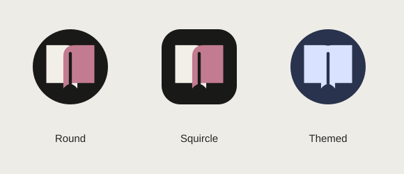

# Litera para Android

Cliente Kotlin com interface Android nativa para login, biblioteca, busca, detalhe, configurações e leitura. Ele consome a mesma API e autorização do Litera instalado por Docker, conforme o [README principal](../README.md). A interface do aplicativo não carrega o site nem instala o PWA dentro de uma WebView.

Os adapters de leitura integram Readium para EPUB e Android PdfRenderer para PDF. Reutilizar uma engine de publicação preserva layout e navegação sem desenvolver um parser/leitor HTML próprio; o renderer EPUB pode usar tecnologia web internamente, limitada ao livro local. A aplicação compartilha contratos de arquivos, locators e conflitos com os demais clientes, sem backend paralelo.

## Instalação e primeira conexão

1. Obtenha o APK de preview nos artifacts do workflow Android; veja [build e distribuição](docs/build-and-release.md).
2. Instale no dispositivo autorizando essa fonte quando o Android solicitar.
3. Informe a origem do servidor, por exemplo `https://livros.example.org`. Instalação em subdiretório não faz parte deste contrato.
4. Entre com sua conta Litera na tela nativa.

No celular, localhost aponta para o próprio aparelho. Use endereço alcançável do servidor e, preferencialmente, HTTPS com certificado válido. HTTP requer consentimento explícito e expõe sessão/conteúdo à rede. Certificados inválidos são recusados.

Sessão e arquivos são privados ao APK e independentes do Chrome/PWA. Login e downloads precisam ser feitos novamente no aplicativo. A senha não é persistida; a sessão persistente usa criptografia com Android Keystore. Arquivos locais são delimitados por origem, conta e revisão do livro. Um arquivo já baixado pode ser reutilizado pelo reader; isso não implementa catálogo completo offline, fila de favoritos/destaques ou sincronização com aplicativo fechado. Posições de leitura possuem um diário durável próprio, com revisão e chave de idempotência. Veja os [limites de arquitetura](docs/architecture.md) e [cenários de validação](docs/testing.md).

Se você instalou o preview antigo baseado no site, sincronize nele antes da atualização. O cliente nativo não importa cookies/IndexedDB desse renderer; posições já confirmadas no servidor continuam disponíveis. Os dados antigos não são apagados automaticamente. Restaurar o avanço de capítulo Android também na web exige o frontend com suporte a `chapterProgression`; clientes anteriores preservam o capítulo, com precisão menor.

A interface nativa usa a identidade e tokens Litera, ícone adaptativo com área segura, barras que acompanham o tema, navegação Voltar e insets para câmera/teclado. Manter a tela acesa é uma preferência restrita à leitura ativa. Recursos web avançados não devem ser anunciados como paridade Android sem implementação e teste correspondentes.



## Desenvolvimento

Requer JDK 17, Android SDK 36 e acesso aos repositórios de dependências. O projeto usa Gradle 9.1.0, Android Gradle Plugin 9.0.1, compile/target SDK 36 e Android 9/API 28 como mínimo. Na pasta android:

```bash
./gradlew testDebugUnitTest lintDebug assembleDebug
./gradlew connectedDebugAndroidTest
```

O segundo comando exige emulador/aparelho conectado. A versão é derivada do package.json raiz; o preview debug usa application ID `io.github.rafaelhschuh.litera.debug`. Confira saída do APK, assinatura e comandos em [build/release](docs/build-and-release.md).

## Contratos e validação

- [Instruções para agentes](AGENTS.md)
- [Arquitetura e responsabilidades](docs/architecture.md)
- [Segurança e limites de rede](docs/security.md)
- [Testes e checklist em aparelho](docs/testing.md)
- [Build, CI, versão e assinatura](docs/build-and-release.md)
- [ADR-0010](../docs/decisions/ADR-0010-native-android-client.md)

O APK de CI é preview, assinado com chave debug efêmera. Não é release assinada estável nem é anexado automaticamente à GitHub Release. Atualizações entre artifacts podem exigir reinstalação e apagar dados locais: sincronize antes. Validação física deve ser registrada; não é inferida de testes de browser ou build.
