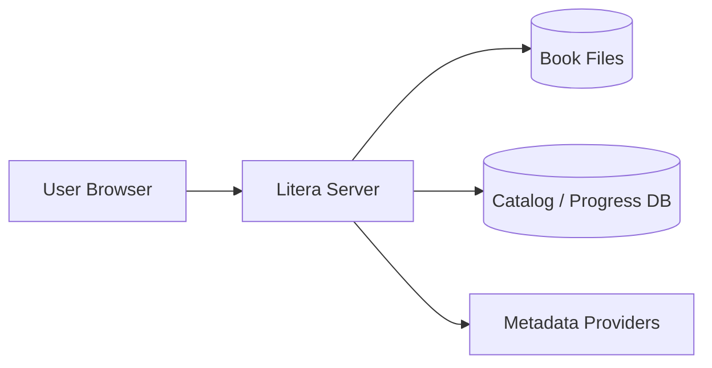

# Architecture Overview

## Context



## Logical containers

- **Web UI:** Vue/TypeScript application; responsive library and reader experience.
- **HTTP/API layer:** authentication, authorization, catalog, reader state, configuration.
- **Library scanner:** filesystem discovery, file identity, parsing/extraction, reconciliation.
- **Metadata engine:** matching and enrichment through provider adapters.
- **Reader subsystem:** format-specific adapters/rendering integration and normalized reader state.
- **Persistence:** catalog, users, metadata, reading progress, preferences.

## Dependency boundaries

- UI communicates with backend through a stable application contract; browser-local state is not the source of truth for progress.
- Scanner owns filesystem reconciliation; it must not let arbitrary web requests become filesystem paths.
- Metadata engine owns external provider calls and matching decisions.
- Reader owns format-specific locators but persists normalized progress through the backend.

## Reader architecture

```text
Reader Shell
  -> Format Adapter
     -> EPUB adapter / PDF adapter
  -> Reader State
     -> locator
     -> derived progress
     -> settings
  -> Progress Sync
     -> debounced persistence
```

A mature parser/rendering library may be used underneath an adapter. The Litera-owned contract remains responsible for UX, state, progress, and integration.

## Deployment

Initial target:

```text
Docker Compose
  ├── Litera application
  └── persistent database/storage
       ├── config
       ├── catalog
       └── mounted book libraries
```

The exact database engine and process split remain engineering decisions unless later requirements make them architectural constraints.

## Android native client

[`android/`](../../android/README.md) is a Kotlin/AndroidX Views client of the existing API, following [ADR-0010](../decisions/ADR-0010-native-android-client.md). Native login, catalog, detail, settings and reader controls use a central HTTP repository. Readium handles EPUB publications and Android PdfRenderer handles local PDF files behind adapters. The application does not load the Litera website; internal EPUB rendering belongs to the publication engine.

Server authorization, file identity/revision and format-aware progress remain shared contracts. Session persistence uses Android Keystore encryption; native files are private and scoped by origin/account/revision. Native cache is distinct from browser storage and does not imply PWA offline/outbox parity. See [architecture](../../android/docs/architecture.md), [security](../../android/docs/security.md) and [validation](../../android/docs/testing.md).
